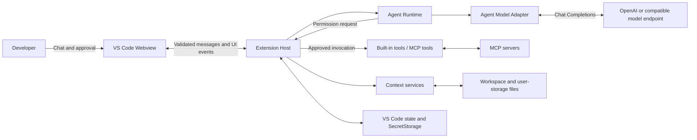
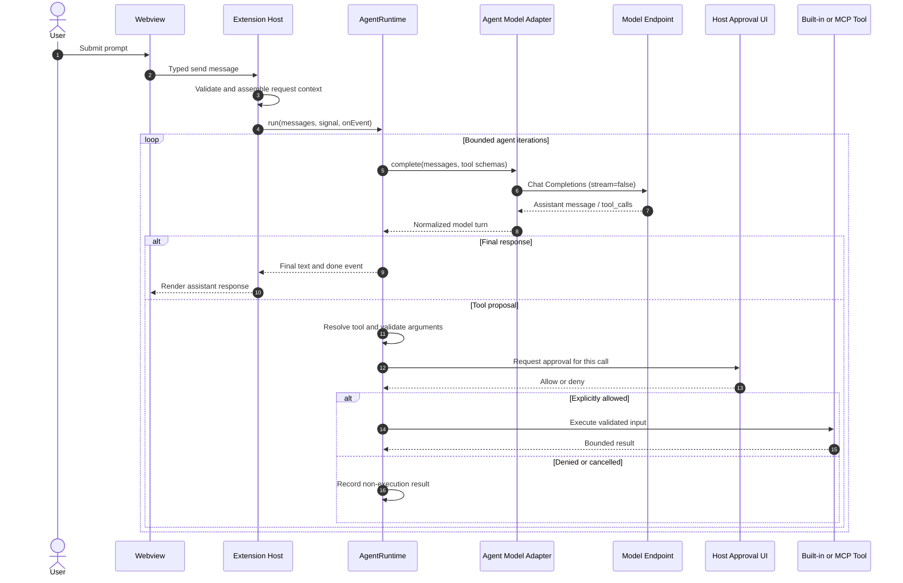

# High-Level Design (HLD)

## 1. Purpose and scope

AI Chatbox is a learning-first AI chat and coding-agent extension for Visual Studio Code. It provides a chat interface, connects to OpenAI or OpenAI-compatible model endpoints, and can orchestrate approved built-in and MCP tools.

The design deliberately keeps the agent loop, tool registry, validation, and permission boundary visible in application code rather than delegating orchestration to a large agent framework.

This document describes the implementation on `feat/phase-1-foundation`. It is an architectural view, not a promise that internal TypeScript modules form a stable third-party SDK.

## 2. Goals and non-goals

### Goals

- Provide a VS Code-native chat experience.
- Support OpenAI and OpenAI-compatible Chat Completions endpoints, including local model servers.
- Keep model-provider details behind a small adapter contract.
- Support bounded, cancellable agent turns and structured tool calls.
- Require explicit user approval for every tool invocation.
- Connect to explicitly configured MCP servers over stdio and Streamable HTTP.
- Add optional skills, local knowledge retrieval, and declarative workflows without giving those features implicit execution authority.
- Keep credentials and privileged operations in the extension host.

### Current non-goals

- A stable third-party TypeScript plugin/extension API.
- Automatic MCP server discovery or automatic connection.
- OAuth-based MCP authentication or external MCP configuration importers.
- Semantic/vector knowledge retrieval or a persistent knowledge index.
- Workflow-driven command execution or automatic tool authorization.
- A general-purpose workflow automation engine.

## 3. System context

The developer interacts with AI Chatbox inside VS Code. The extension host communicates with the configured model endpoint and, when the user has configured and approved connections, with MCP servers. Workspace and user-storage files may supply optional skills, workflows, and knowledge.

The diagram is conceptual. The webview does not call the model or tools directly; the extension host mediates those operations.

## 4. Container and component architecture

| Component | Responsibility | Trust / authority |
| --- | --- | --- |
| Chat Webview (`chatView.ts`) | Conversation UI, composer, status/progress display, tool approval controls, and the webview message bridge | Untrusted presentation layer. No credentials, direct model requests, or tool execution |
| Extension Host (`extension.ts`) | Activation, VS Code commands/configuration, context assembly, ChatView lifecycle, permission prompts, MCP lifecycle, and state integration | Trusted application boundary; owns privileged VS Code APIs and coordinates side effects |
| Chat Model Client (`modelClient.ts`) | Streaming text-only Chat Completions requests and HTTP/SSE handling | Host-side network client |
| Agent Runtime (`agentRuntime.ts`) | Provider-independent bounded loop, tool registry, argument validation, permission gate, cancellation, and lifecycle events | Orchestration and policy enforcement |
| Agent Model Adapter (`agentModelAdapter.ts`) | Converts internal messages/tool schemas to OpenAI Chat Completions requests and normalizes structured responses | Provider protocol adapter; model output remains untrusted |
| MCP Manager (`mcpManager.ts`) | Validates server configuration, manages transports/sessions, discovers tools, validates tool input, maps results, and reports connection diagnostics | Host-side external process/network boundary |
| Skill modules | Parse, validate, select, and format optional skill manifests | User-authored untrusted guidance; never executable |
| Knowledge index (`knowledgeIndex.ts`) | Bounded lexical indexing and ranking of local Markdown/text excerpts | User/workspace content; request-scoped untrusted reference material |
| Workflow modules | Load/validate versioned workflow definitions, advance run state, and validate saved run snapshots | Declarative instructions and approval checkpoints; no direct tool execution |
| VS Code storage | Optional conversation and workflow state; credentials in SecretStorage | Host-controlled persistence |

## 5. Major runtime flows

### 5.1 Text-only chat

1. The user submits a message in the webview.
2. The webview sends a typed message to the extension host.
3. The host validates the incoming message and manages the conversation lifecycle.
4. The host invokes the streaming chat client.
5. The client sends a streaming Chat Completions request to the configured endpoint.
6. Text deltas and completion/error events are relayed to the webview.
7. The UI renders response text as text, not HTML.

The text-only chat path streams content. The agent path below uses a separate non-streaming adapter so that structured tool-call IDs and arguments are available before any tool can run.

### 5.2 Agent turn and tool execution

1. The host assembles the model messages and available tool definitions.
2. The host starts an `AgentRuntime` run with an `AbortSignal` and event callback.
3. The runtime asks the model adapter for a completion.
4. A final response ends the run. A structured tool proposal is resolved against the registered tool set and validated.
5. The runtime requests a permission decision for that specific invocation.
6. Only an explicit allow decision permits execution. Denied, invalid, unknown, cancelled, or over-limit calls do not execute.
7. A bounded tool result is appended to the conversation and the model loop continues until completion or a limit is reached.

### 5.3 MCP connection and invocation

- Server definitions are supplied through `aiChatbox.mcpServers`.
- A server is not connected merely because it is configured. The user invokes the Connect command and confirms the reviewed command or endpoint.
- Supported transports are stdio and Streamable HTTP.
- Remote endpoints must use HTTPS; localhost HTTP is allowed for development.
- Stdio processes receive a constrained environment plus explicitly configured variables.
- Bearer credentials are stored in VS Code SecretStorage, not settings or URLs.
- Tool discovery makes schemas available to the agent. It does not authorize execution.
- Every discovered tool invocation still passes through the agent's per-call approval gate.
- The user can inspect connection status/diagnostics and manually reconnect. The manager also handles tool-list changes and refreshes discovered schemas.
- MCP resources and prompts can be browsed locally. Their content is not automatically included in model context; the user must explicitly attach reviewed content to the next request.

### 5.4 Optional context features

**Skills:** When enabled, JSON manifests are loaded from workspace and user-storage locations, validated, selected by keyword overlap, and formatted as untrusted instructions. Skills do not run scripts, add tools, or grant permissions.

**Knowledge:** When enabled, Markdown/text files from the documented knowledge locations are indexed for the request using bounded lexical matching. Up to five relevant excerpts are included as untrusted reference context with source paths. There is no embedding service or persistent vector index.

**Workflows:** When enabled, versioned JSON definitions describe sequential instruction steps and approval checkpoints. A workflow run is a state machine with validated outcomes, optional bounded manual retries, and resumable snapshots. Workflow steps do not execute tools or commands and do not grant tool permission.

These features are opt-in and disabled by default.

## 6. Data and state

| Data | Location / lifetime | Notes |
| --- | --- | --- |
| Model/provider settings | VS Code configuration | Includes provider, model ID, compatible base URL, and request timeout |
| OpenAI API key | VS Code SecretStorage | Never placed in settings or webview state |
| MCP bearer tokens | VS Code SecretStorage | Stored separately per configured server |
| Active chat history | In-memory host-side state associated with the chat panel | Bounded; closing the panel clears in-memory history |
| Saved conversation | VS Code workspace state, only when enabled | Disabled by default because transcripts can contain sensitive data; validated and bounded on load |
| Workflow run snapshots | VS Code extension global state | Validated on load; at most 10 snapshots and 200 KB total |
| Skills / workflows / knowledge | Workspace and extension user-storage files | User-controlled inputs; features are opt-in and inputs are validated/bounded |

## 7. Security architecture and invariants

1. **Host owns authority.** Credentials, model requests, MCP transports, filesystem operations, and permission decisions stay in the extension host.
2. **Webview is untrusted.** Validate every incoming webview message in the host. Use a strict Content Security Policy and no local file resource roots.
3. **Model output is not authority.** A tool call is only a proposal. It must resolve to a registered tool, pass argument validation, and receive explicit per-invocation approval.
4. **Connection is not execution permission.** Approving an MCP connection does not approve any tool call from that server.
5. **Secrets stay in SecretStorage.** Do not put API keys or bearer tokens in settings, source control, logs, URLs, or webview state.
6. **Bound resource use.** Bound iterations, calls, history, context, file sizes/counts, outputs, and request duration. Support cancellation.
7. **Treat external text as untrusted.** Tool results, MCP attachments, skills, and retrieved knowledge cannot override system/developer policy or the user's request.
8. **Render text safely.** Render user/model/tool text as text, not executable HTML.
9. **Diagnostics must be safe.** Avoid exposing tokens, authorization headers, or URL query strings/fragments in diagnostics.

## 8. Configuration and operational model

Important settings include:

| Setting | Default | Meaning |
| --- | --- | --- |
| `aiChatbox.provider` | `openai-compatible` | `openai` or `openai-compatible` |
| `aiChatbox.modelId` | `qwen2.5-coder:7b` | Model identifier sent to the endpoint |
| `aiChatbox.baseUrl` | `http://localhost:11434/v1` | Compatible endpoint base URL; ignored for OpenAI |
| `aiChatbox.requestTimeoutMs` | `120000` | Request timeout, bounded to 1–300 seconds |
| `aiChatbox.skillsEnabled` | `false` | Opt-in skill loading |
| `aiChatbox.knowledgeEnabled` | `false` | Opt-in local retrieval |
| `aiChatbox.workflowsEnabled` | `false` | Opt-in workflow loading |
| `aiChatbox.persistConversation` | `false` | Opt-in transcript persistence |

Build and validation commands are `npm run check-types`, `npm test`, and `npm run build`. The VSIX packaging command is `npm run package`.

## 9. Key design trade-offs

- **Separate streaming and agent paths:** text-only chat streams for responsiveness; agent calls are non-streaming to preserve complete structured tool-call data before authorization.
- **Explicit approvals:** adds interaction overhead but ensures model output cannot silently perform actions.
- **Host-side policy:** keeps secrets and privileged APIs out of the webview and makes runtime behavior testable.
- **Opt-in context features:** avoids unexpectedly sending local documents or custom instructions to a model provider.
- **Lexical retrieval first:** simple, deterministic, and local; less semantically capable than embeddings, but easier to inspect and bound.
- **Declarative workflows:** provides repeatable guidance and checkpoints without introducing arbitrary workflow code execution.

## 10. Known limitations and future extension points

- Internal TypeScript seams are not a stable public plugin API.
- Tool calling depends on the selected model/server correctly implementing the expected OpenAI-compatible `tools` and `tool_calls` fields.
- Knowledge retrieval is lexical, not semantic, and the index is rebuilt for requests rather than persisted.
- Skills are selected by keyword overlap rather than a model-driven planner.
- Workflows guide the user; they do not autonomously execute actions.
- MCP OAuth and external configuration importers are not implemented.

For exact module contracts, see [LLD.md](./LLD.md), [EXTENSION-INTERFACES.md](./EXTENSION-INTERFACES.md), and the source files referenced above.
