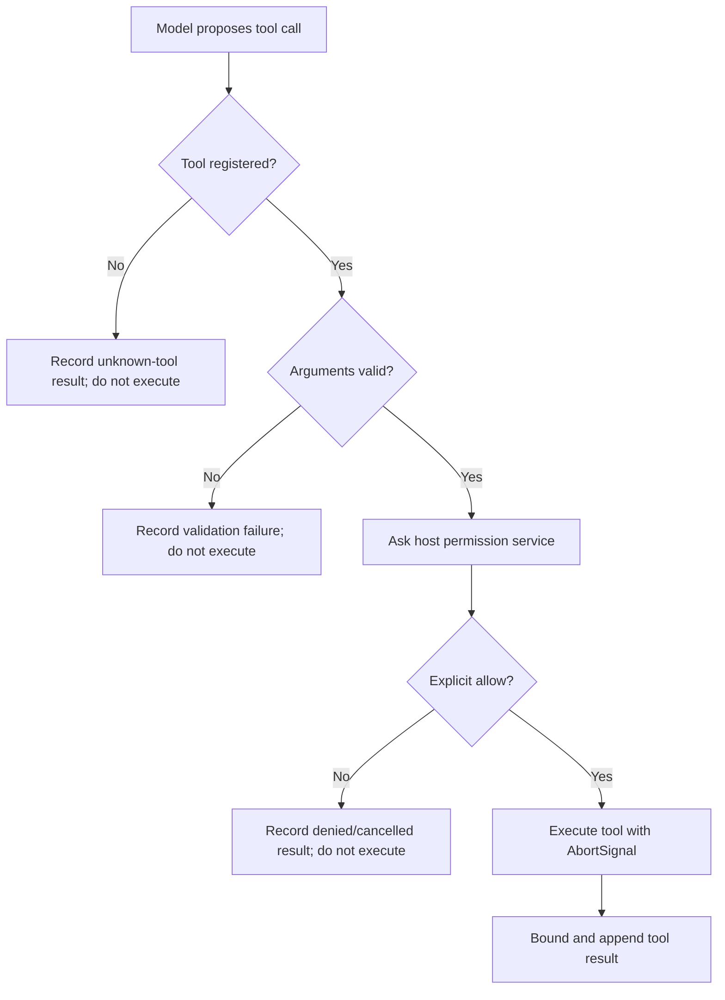

# Low-Level Design (LLD)

## 1. Purpose

This document describes the implementation-level responsibilities and interactions of the current AI Chatbox code. It complements [HLD.md](./HLD.md), which describes system boundaries and major flows.

The source of truth for exact TypeScript signatures is the implementation on `feat/phase-1-foundation`. Internal module exports are not a stable third-party API.

## 2. Module map

| Module | Main responsibility | Important collaborators |
| --- | --- | --- |
| `src/extension.ts` | VS Code activation, command registration, configuration access, ChatView setup, context assembly, permission UI, MCP commands, workflow commands, and state coordination | ChatView, McpManager, model client, AgentRuntime, context/storage modules |
| `src/chatView.ts` | Webview panel construction, HTML/CSP, typed message bridge, UI event handling, streaming display, approval UI, and lifecycle | VS Code Webview API; host callbacks supplied by extension |
| `src/modelClient.ts` | Model configuration, endpoint construction, streaming text completion, SSE parsing, and HTTP error handling | Fetch API; configured provider endpoint |
| `src/agentModelAdapter.ts` | Converts internal agent messages/tool definitions to OpenAI Chat Completions format and normalizes assistant/tool-call responses | AgentRuntime; model endpoint |
| `src/agentRuntime.ts` | Provider-independent agent loop, tool registry, validation, approval gate, event emission, and bounds | AgentModelAdapter, AgentToolDefinition, ToolPermissionService |
| `src/mcpManager.ts` | MCP config validation, transport/session lifecycle, discovery, schema validation, invocation mapping, notifications, and diagnostics | MCP TypeScript SDK, Ajv, AgentRuntime tool contract |
| `src/mcpContext.ts` | Formats explicitly selected MCP resource/prompt content for request context | MCP resource/prompt data |
| `src/skillRegistry.ts`, `src/skillLoader.ts` | Skill manifest validation, registration/selection, file loading, and safe context formatting | Workspace/user-storage JSON files |
| `src/knowledgeIndex.ts` | Bounded chunking, lexical ranking, and untrusted context formatting | Workspace/user-storage Markdown/text |
| `src/workflowRuntime.ts`, `src/workflowLoader.ts` | Workflow manifest validation/loading and deterministic run-state transitions | Workspace/user-storage JSON workflow definitions |
| `src/workflowRunStore.ts` | Validation and bounded persistence of workflow run snapshots | VS Code global state |
| `src/conversationStore.ts` | Validation of saved agent messages and conversion to a simple transcript | VS Code workspace state; AgentMessage types |

## 3. Core interfaces

### 3.1 Agent model adapter

The runtime depends on a provider-neutral contract:

- Input: `AgentModelRequest` containing messages, tool specifications, and an `AbortSignal`.
- Output: `AgentModelTurn`, either a final text response or a list of structured tool calls.
- Adapter operation: `complete(request): Promise<AgentModelTurn>`.

The concrete `createAgentModelAdapter` implementation:

1. Validates that the model ID is non-empty and that an OpenAI API key exists when the OpenAI provider is selected.
2. Creates a timeout controller and forwards cancellation from the runtime signal.
3. Serializes internal tool messages to provider fields such as `tool_call_id` and `tool_calls`.
4. Sends a non-streaming Chat Completions request (`stream: false`).
5. Includes function tool schemas and `tool_choice: "auto"` when tools are available.
6. Parses the first assistant message. If `tool_calls` are present, it parses each function argument JSON and returns normalized calls. Invalid JSON is represented as invalid input for the runtime/tool validation path rather than executed.
7. Converts HTTP, JSON, timeout, and cancellation failures into bounded, readable errors.

The OpenAI provider uses the official API base URL. The compatible provider uses the configured base URL; `getCompletionEndpoint` appends the Chat Completions path as needed.

### 3.2 Agent runtime contracts

Important types in `agentRuntime.ts`:

- `AgentToolCall`: provider call ID, tool name, and untrusted arguments.
- `AgentToolDefinition`: name, description, optional JSON Schema, input validator, and async executor.
- `AgentToolSpec`: the model-visible subset of a tool definition.
- `AgentMessage`: system/user/assistant messages, assistant messages with tool calls, and tool-result messages.
- `ToolPermissionService`: asynchronous `requestPermission` decision returning `allow` or `deny`.
- `AgentEvent`: typed lifecycle events such as thinking, assistant text, proposal, approval requested, started, finished, denied, error, and done.

Default runtime bounds in the current source:

| Limit | Default |
| --- | ---: |
| Model iterations per run | 8 |
| Tool calls per turn | 8 |
| Tool result characters | 8,000 |
| History messages retained by runtime | 40 |

The constructor also clamps configured limits to safe ranges. Tool names must match the allowed identifier pattern and duplicates are rejected.

## 4. Agent turn algorithm

The following is the logical algorithm implemented by `AgentRuntime.run`:

1. Copy only the most recent bounded history messages.
2. For each iteration, check cancellation and emit a `thinking` event.
3. Call the model adapter with a copy of the current messages and the registered tool specifications.
4. Check cancellation again after the model response.
5. If the adapter returns a final response:
   - append the assistant message;
   - emit the assistant text event when non-empty;
   - emit `done(completed)`;
   - return the bounded message list and final text.
6. If the adapter returns tool calls:
   - append an assistant message containing those calls;
   - emit any accompanying assistant text;
   - process calls sequentially.
7. For each call:
   - stop processing if the run has been cancelled;
   - if the per-turn call limit has been reached, append a non-executed tool result explaining the limit;
   - look up the tool by name; unknown names are not executed;
   - call the tool's `validateInput`; invalid arguments are not executed;
   - emit proposal/approval lifecycle events and request permission;
   - execute only when the permission service explicitly returns `allow`;
   - pass the cancellation signal to the executor;
   - normalize and truncate the result to the configured output bound;
   - append a tool-role message linked to the original tool-call ID.
8. Continue the model loop with the tool results.
9. If the iteration bound is exhausted, emit `done(iteration-limit)` and return the bounded state.
10. Cancellation is surfaced as a cancelled run; errors are emitted as error events and do not turn into implicit permission.

A missing permission implementation must not be interpreted as approval. The safe default permission behavior denies tool execution.

## 5. Tool registration and authorization

A tool definition contains:

- A stable-in-process name and description.
- Optional JSON Schema exposed to the model.
- A host-side validator for the actual input.
- An executor receiving validated input and an `AbortSignal`.

The model sees tool names, descriptions, and schemas; it does not receive an executable function. The runtime resolves the model's proposal against its own registry. Schema text alone is not a substitute for host-side validation.

The authorization sequence is:



Approval is per invocation, not a persistent grant. Connecting an MCP server or discovering its tools does not authorize those tools.

## 6. Webview and extension-host boundary

### 6.1 Webview responsibilities

The webview is responsible for presentation:

- Displaying conversation messages and streaming text.
- Sending user actions through the VS Code webview message bridge.
- Displaying progress/status and tool approval prompts.
- Sending an explicit allow/deny decision for the currently pending tool proposal.
- Rendering content as text rather than interpreting model output as HTML.

### 6.2 Host responsibilities

The extension host:

- Validates message type, shape, and bounds.
- Owns model configuration, credentials, network requests, MCP clients, and filesystem access.
- Creates and runs the agent runtime.
- Displays the approval UI and resolves the pending permission request.
- Converts runtime events into webview updates.
- Cancels work when the user stops a run or the panel is disposed.

The webview must never receive API keys, MCP bearer tokens, or privileged tool implementations. Its messages are untrusted even though they originate from the extension's own UI.

## 7. MCP implementation details

### 7.1 Configuration and connection

`McpServerConfig` is a discriminated union:

- Stdio: `transport: "stdio"`, `command`, optional `args`, `cwd`, and `env`.
- Streamable HTTP: `transport: "streamable-http"` and `url`.

The manager parses and validates configuration before connecting. The extension host presents the parsed command or safe endpoint summary in a confirmation dialog. Only after the user confirms does the manager create the SDK client and transport.

Remote HTTP endpoints require HTTPS; localhost HTTP is allowed for local development. Stdio environment inheritance is constrained. Bearer tokens are retrieved from SecretStorage and supplied to the transport without being written to ordinary settings.

### 7.2 Tool discovery and invocation

1. Connect the SDK client over the selected transport.
2. List server tools and normalize their names, descriptions, and input schemas.
3. Validate discovered input schemas and build internal tool definitions.
4. Expose those definitions to AgentRuntime as ordinary tools.
5. When invoked, validate the proposed input against the discovered schema (using Ajv) before making the MCP call.
6. Map the MCP result into a bounded internal tool result.
7. Route all calls through the same AgentRuntime permission service as built-in tools.

Tool-list-change notifications trigger schema refresh. Connection state and failures are tracked with stage-aware diagnostics; reconnection is user initiated rather than an implicit retry loop.

### 7.3 Resources and prompts

The manager can list/read MCP resources and list/get MCP prompts. The extension surfaces these for local review. Content is not automatically inserted into the model request. A user explicitly selects and confirms an attachment; the resulting bounded context is associated with the next message, labeled untrusted, and is not stored as ordinary conversation history. Resource and prompt content does not grant tool permissions.

## 8. Context services

### 8.1 Skills

- Skill manifests are JSON data loaded only when `aiChatbox.skillsEnabled` is true.
- Workspace manifests live under `.ai-chatbox/skills/`; user manifests live in extension global storage.
- `skillLoader.ts` bounds file count and size, parses JSON, validates manifests through `parseSkillManifest`, and skips invalid files.
- `SkillRegistry` selects matching skills using keyword overlap.
- `formatSkillContext` labels the selected instructions as untrusted reference material and bounds the final context.
- Skill files are never evaluated as scripts; skills cannot register tools or grant authority.

### 8.2 Local knowledge

- Knowledge retrieval is disabled unless `aiChatbox.knowledgeEnabled` is true.
- Markdown/text files are read from the workspace and user-storage knowledge locations.
- `buildKnowledgeIndex` splits content into bounded paragraph chunks and tracks source path/title.
- `searchKnowledge` tokenizes the query, ignores stopwords, scores exact token overlap, boosts title/path matches, and uses deterministic tie-breaking.
- The request formatter labels excerpts as untrusted reference material and includes source paths.
- Up to five relevant excerpts are added to the current request. The index is lexical and request-scoped; no embedding provider or persistent vector index is used.

### 8.3 Workflows

- Workflow definitions are versioned JSON manifests loaded only when `aiChatbox.workflowsEnabled` is true.
- `workflowRuntime.ts` validates manifest IDs, semantic versions, step IDs, step text, conditions, and retry policies.
- A run advances through instruction and approval steps in order. Conditions can skip steps based on earlier outcomes.
- Instruction completion and approval decisions are explicit transitions. Manual retry is bounded to a small number of attempts.
- Workflow steps are instructions/checkpoints, not executable commands or tool invocations.
- `workflowRunStore.ts` validates snapshots before restoring them, retains at most 10 records, and enforces a 200 KB total state budget.

## 9. Persistence

### Conversation persistence

`conversationStore.ts` treats restored state as untrusted. It validates message roles and fields, rejects malformed/oversized transcripts, validates tool-call identifiers and arguments, and enforces bounds (40 messages, 250 KB serialized state, 50,000 characters per message, and at most 8 tool calls per assistant message). Conversation persistence is opt-in and disabled by default.

### Workflow persistence

Workflow snapshots are stored in extension global state. On load, each record is parsed and validated against the workflow manifest and its state-transition invariants. Invalid records are discarded individually. The store keeps at most 10 snapshots and at most 200 KB total.

### Secrets

OpenAI API keys and MCP bearer tokens are stored in VS Code SecretStorage. They are not part of conversation snapshots or webview messages.

## 10. Error handling, cancellation, and observability

- Model requests have a configurable timeout bounded to 1–300 seconds.
- Agent runs receive an `AbortSignal`; cancellation is checked around model calls and before tool processing, and is passed to tool executors.
- The runtime emits typed events so the host can update the UI without coupling the core loop to VS Code APIs.
- Model HTTP errors, invalid JSON, missing assistant messages, timeouts, and cancellation are converted to readable failures.
- MCP connection diagnostics distinguish configuration, transport connection/error, tool discovery/schema refresh, and unexpected disconnect stages.
- Diagnostic messages are bounded and endpoint summaries remove query strings and fragments to avoid leaking credentials.

## 11. Testing strategy

Tests should preserve the module boundaries and security invariants:

| Area | Test focus |
| --- | --- |
| Model client | Endpoint construction, streaming/SSE parsing, missing credentials, timeout and HTTP errors |
| Agent runtime | Final response, tool execution, denial, invalid arguments, unknown tools, cancellation, iteration/tool/output/history limits |
| Agent adapter | Provider message mapping, structured tool-call parsing, malformed arguments, HTTP/JSON/timeout failures |
| MCP manager | Config validation, transport lifecycle, tool discovery/schema validation, safe diagnostics, disconnect and notification behavior |
| Skills / knowledge | Manifest/file validation, selection/ranking determinism, size/count bounds, untrusted-context formatting |
| Workflows | Manifest validation, legal transitions, conditions, retry limits, persistence validation and resume |
| Conversation store | Valid/invalid transcript handling, schema and size limits |

The standard validation commands are:

```bash
npm run check-types
npm test
npm run build
```

## 12. Implementation caveats

- The webview/host protocol and TypeScript exports are internal implementation details, not a published SDK.
- The standard chat path and agent path have different streaming behavior by design.
- Structured tool calling depends on model/server compatibility with OpenAI Chat Completions tool-call fields.
- MCP connection approval and per-call tool approval are separate gates.
- Skills, knowledge, and workflows are disabled by default.
- Knowledge search is lexical; workflows are user-guided and do not execute tools.
- Resource/prompt attachment is an explicit one-request context action, not automatic retrieval.
